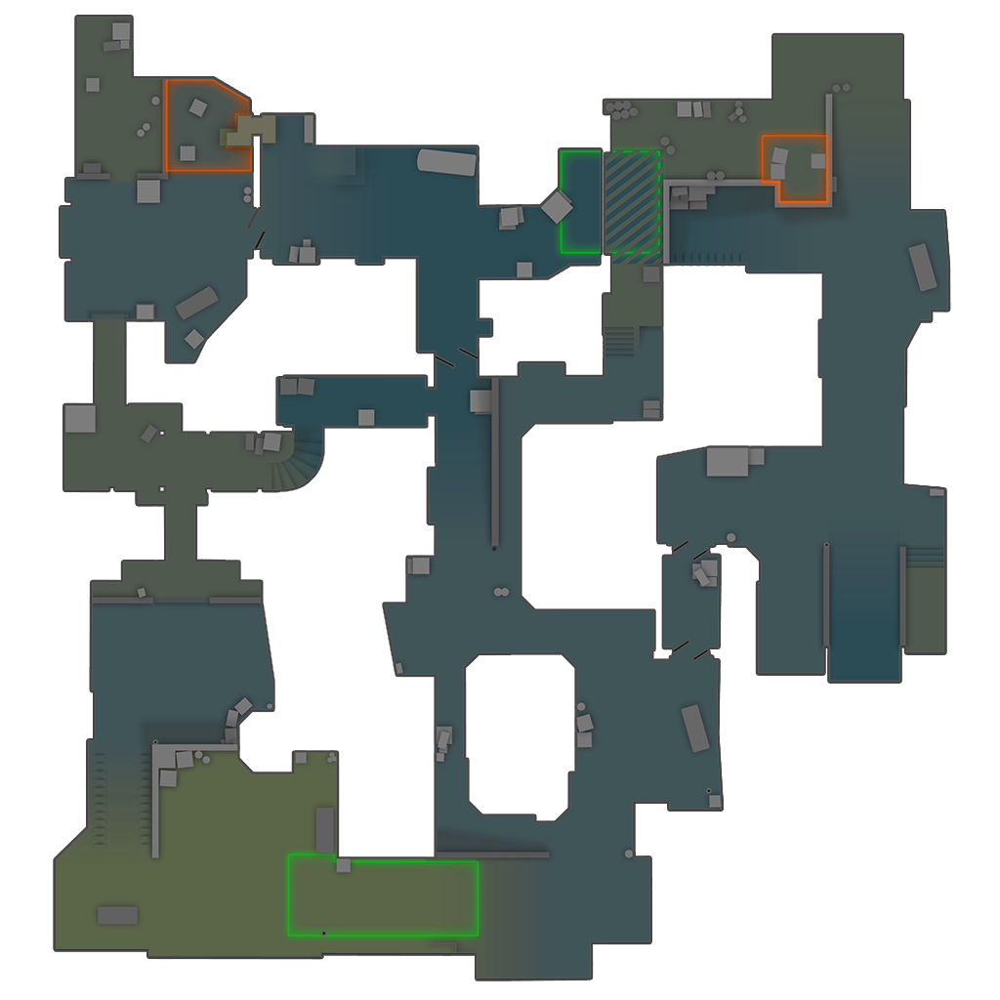

# 🎯 SimulatorX — CS:GO Pure Coach Simulator (Taktiksel Koçluk)

**SimulatorX**, oyuna dışarıdan hiçbir müdahalenin olmadığı (silah seçimi, tempo veya hareket emri verilmediği); oyuncuların profesyonel CS:GO kurallarıyla otonom olarak mücadele ettiği, kullanıcının yalnızca **Taktiksel Mola (Timeout)** alabilme yetkisine sahip olduğu saf bir **CS:GO Koç Simülatörüdür**.



---

## 🌟 Oyun Mekanikleri ve Koç Yetkisi

1. **Sıfır Dış Müdahale:**
   - Koç olarak silah satın alamaz, flaş atamaz, hareket veya tempo emri veremezsiniz.
   - Her takımın In-Game Leader'ı (IGL - Twistzz / electronic) raund başında stratejiyi (Rush B, Long A Execute, Standart 2-1-2 vb.) kendisi belirler.
   - Oyuncular bütçelerine göre kendi silahlarını alır (Full buy, Eco, Force buy), çatışmaya girer, duman ve flaşlarını atar, bombayı kurar ve çözerler.

2. **Tek Yetki: Taktiksel Mola Al (Tactical Timeout - 25s):**
   - Her takımın maç boyunca **2 mola hakkı** vardır.
   - Mola alındığında maç 25 saniye duraklar.
   - Mola alan takımın oyuncularının **tilt seviyeleri sıfırlanır ve moralleri yükselir**, böylece sonraki rauntlara toparlanmış olarak başlarlar.

3. **Büyük Radar Üzerinde 5v5 Canlı Maç:**
   - 1024x1024 orijinal Valve de_dust2 radar haritası.
   - Gerçekçi görüş konileri (Vision Cones), duvar arkası görmeyi engelleyen raycasting motoru, insan tepki süresi (180ms-260ms), counter-strafing ve tepme yönetimi.

4. **Maç Kontrolleri:**
   - Maçı Başlat (Lobi modundan çıkış)
   - Duraklat / Sürdür
   - Sıfırla (Lobiye dön)
   - TAB: Resmi CS:GO Skor Tablosu

---

## 🚀 Çalıştırma

```bash
cd simulatorx
npm install
npm start
```

Tarayıcınızda açın:
```
http://localhost:3000
```
